# production-agentic-ai-patterns

> **12 production-grade AI agent projects, built from first principles in Python with the OpenAI API (`gpt-5-nano`).**
> They cover reliability, grounding, planning, orchestration, memory, human oversight, cost control, event-driven automation, multi-agent systems, self-improvement, observability and an open-source contribution. Every example comes from the payments and fraud domain.

| | |
|---|---|
| **Stack** | Python 3.10+, OpenAI SDK, Pydantic v2, FastAPI, SQLite, NumPy, LangGraph (P12) |
| **Default model** | `gpt-5-nano`, configurable via `.env`; P7 can escalate to `gpt-5-mini` |
| **Tests** | 38 offline, deterministic tests that use a scripted `FakeLLM`. No API cost. |
| **Runs without a key** | Yes. Offline `MockLLM` mode shows the plumbing; add a key for real answers |

---

## Table of contents

1. [Quick start](#quick-start)
2. [Repository layout](#repository-layout)
3. [Shared core architecture](#shared-core-architecture)
4. Projects
   1. [Structured Output Agent](#p1--structured-output-agent)
   2. [RAG Agent with Citation Grounding](#p2--rag-agent-with-citation-grounding)
   3. [ReAct Planning Agent](#p3--react-planning-agent)
   4. [Multi-Tool Orchestrator Agent](#p4--multi-tool-orchestrator-agent)
   5. [Memory-Enabled Conversational Agent](#p5--memory-enabled-conversational-agent)
   6. [Human-in-the-Loop Approval Agent](#p6--human-in-the-loop-approval-agent)
   7. [Cost-Aware Agent Router](#p7--cost-aware-agent-router)
   8. [Event-Triggered Automation Agent](#p8--event-triggered-automation-agent)
   9. [Multi-Agent Debate System](#p9--multi-agent-debate-system)
   10. [Self-Reflective Agent with Auto-Eval](#p10--self-reflective-agent-with-auto-eval)
   11. [Production Agent with Observability](#p11--production-agent-with-observability)
   12. [Open-Source Framework Contribution (LoopGuard)](#p12--open-source-framework-contribution-loopguard)
5. [Configuration reference](#configuration-reference)
6. [Testing strategy](#testing-strategy)
7. [Cost notes](#cost-notes)

---

## Quick start

```powershell
# Windows PowerShell (macOS/Linux: source .venv/bin/activate)
python -m venv .venv
.venv\Scripts\activate
pip install -r requirements.txt

# .env must contain your key (see .env.example):
#   OPENAI_API_KEY=sk-...
#   OPENAI_MODEL=gpt-5-nano

python -m pytest                          # 38 offline tests
python -m p01_structured_output.run       # any project: python -m pXX_<name>.run
```

The API key is read **only** from `.env` by `common/config.py`. Every project then gets its client from `common.llm.get_llm()`, which follows these rules:

* **Valid key in `.env`:** real `gpt-5-nano` calls through `OpenAILLM`.
* **No key, or `LLM_MODE=mock`:** offline `MockLLM`, with zero cost.
* **Tests:** always offline. `tests/conftest.py` forces mock mode, so `pytest` never spends tokens.

---

## Repository layout

```
production-agentic-ai-patterns/
├── common/                      # shared core used by all projects
│   ├── config.py                # .env loading, model names, pricing table, cost_usd()
│   ├── llm.py                   # OpenAILLM / FakeLLM / MockLLM, Usage, listeners, retries
│   ├── structured.py            # Pydantic-validated JSON generation with repair retries
│   ├── tools.py                 # typed Tool (validated args + outputs, scopes, capabilities)
│   ├── embeddings.py            # local hashing embedder / OpenAI embeddings + VectorStore
│   └── utils.py                 # JSONL logging, safe arithmetic evaluator
├── p01_structured_output/       # one package per project, each with run.py
├── p02_rag_citations/
├── p03_react_planning/
├── p04_multi_tool_orchestrator/
├── p05_memory_agent/
├── p06_hitl_approval/           # + api.py (FastAPI reviewer API)
├── p07_cost_router/
├── p08_event_automation/        # + api.py (webhook receiver + workers)
├── p09_multi_agent_debate/
├── p10_self_reflective/
├── p11_observability/           # + dashboard.py (FastAPI ops dashboard)
├── p12_oss_contribution/        # LoopGuard package, examples, benchmarks, PR draft
├── tests/                       # offline test suite
├── data/                        # runtime artifacts: logs, SQLite DBs, traces (git-ignored)
├── .env.example  requirements.txt  pytest.ini
```

---

## Shared core architecture

Every project is built on the same small core, so cross-cutting concerns live in one place. Those concerns are model access, cost accounting, validation, tracing hooks and test doubles.

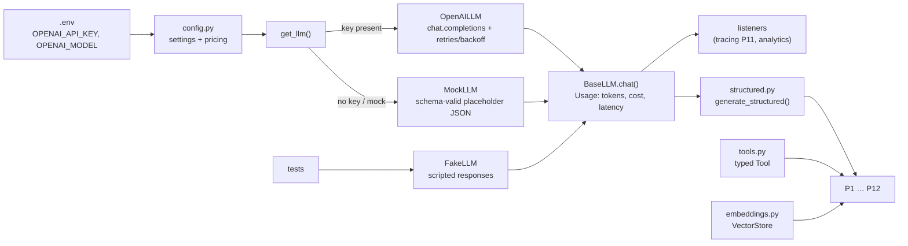

**Key design decisions**

* **One LLM interface, three implementations:** real, mock and fake. Each agent receives its `llm` as a dependency, so it is unit-testable without network calls.
* **Usage tracking at the source:** each call records prompt, completion, reasoning and cached tokens, plus latency and USD cost. Listeners let tracing and analytics subscribe without touching agent code.
* **`generate_structured()`** is the reliability primitive, reused by 10 of the 12 projects. It works in four steps:
  1. Request JSON-schema output.
  2. Validate it with Pydantic.
  3. On failure, send the **exact validation error** back as a repair prompt.
  4. Retry, then raise `StructuredOutputError`.
* **gpt-5 specifics:** gpt-5 models take no `temperature`. Depth is controlled with `reasoning_effort` (`minimal` / `low` / `medium` / `high`), and `max_completion_tokens` includes reasoning tokens.

---

## P1 · Structured Output Agent

**Goal:** make LLM output *reliable, not random*. Responses are enforced with Pydantic schemas, tool responses are validated, the agent retries on parse errors, and validation failures are logged.

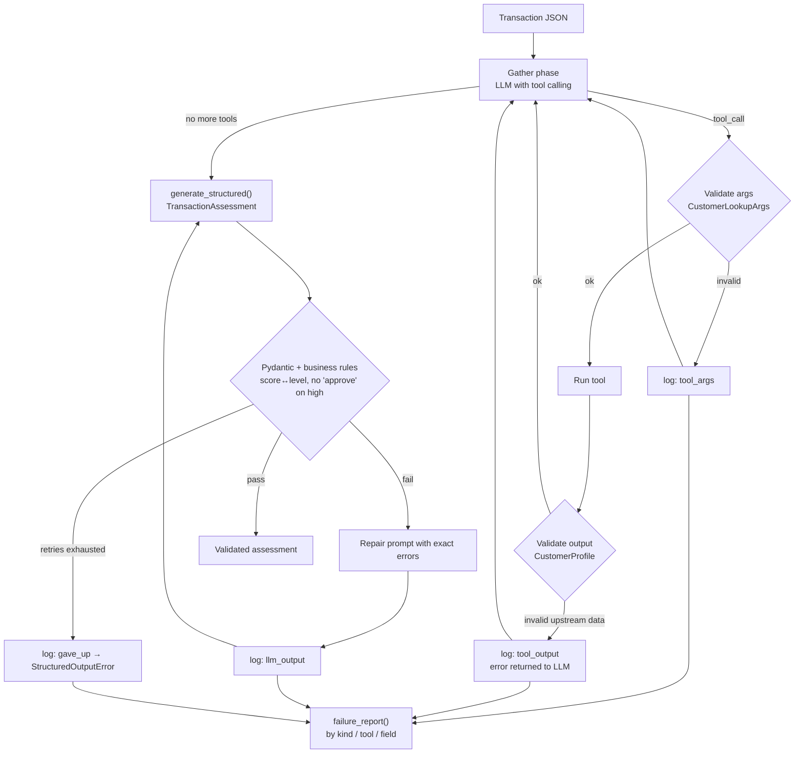

| Component | File | Responsibility |
|---|---|---|
| Schemas | `schemas.py` | `TransactionAssessment` (field + **model validators** for business consistency), tool arg/output contracts |
| Agent | `agent.py` | Tool-calling gather loop, validated tools, structured final answer, JSONL failure log |
| Engine | `common/structured.py` | JSON extraction (code fences, chatter), validation, repair loop |

* **Notable detail:** customer `C3003` is a deliberately corrupt upstream record (`home_country="INDIA"`, negative account age). Tool-output validation catches it, and the LLM is told the tool failed instead of reasoning on bad data.
* **Run:** `python -m p01_structured_output.run`
* **Artifacts:** `data/p01_validation_failures.jsonl`

---

## P2 · RAG Agent with Citation Grounding

**Goal:** prevent hallucinations at scale. The agent retrieves context and answers with sources. It flags low-confidence answers and falls back to search.

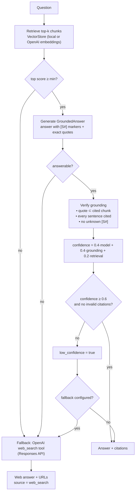

**Ingestion:** markdown policy docs (`docs/`) are split into paragraph chunks of about 300 characters. Each chunk ID is `file#n` and keeps its document title for attribution.

**Grounding score:** `citation_precision × (0.5 + 0.5 × sentence_coverage)`. The score is multiplicative, so a single fabricated quote collapses it, and any invalid citation forces `low_confidence`.

**Why the score blends three signals:** model self-confidence alone is poorly calibrated. Combining it with *verifiable* grounding and retrieval strength gives a confidence you can act on.

* **Run:** `python -m p02_rag_citations.run`
* **Tip:** set `EMBEDDINGS_BACKEND=openai` for semantic retrieval. The default hashing embedder is lexical.

---

## P3 · ReAct Planning Agent

**Goal:** an agent that **never infinite-loops**. It runs an Observe → Think → Act → Reflect loop with hard limits, self-critique and graceful degradation.

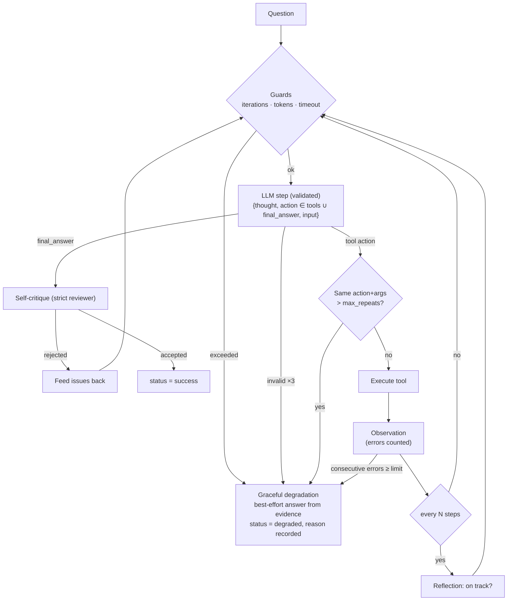

| Safety mechanism | How it works |
|---|---|
| Action whitelist | `action` is a `Literal[...]` of real tool names, built with `create_model`. A hallucinated tool fails validation and gets repaired. |
| Loop detection | Counts each (action, args) signature. A warning goes into the observation at the limit, and one more repeat stops the run. |
| Budgets | Max iterations, token budget computed from `Usage`, and a wall-clock timeout. |
| Self-critique gate | The final answer is reviewed against the evidence before it is accepted. |
| Degradation | When a limit is hit, one final call summarises the gathered evidence and states what is uncertain. The run never crashes. |

**Tools:** safe calculator (AST, no `eval`), currency conversion, policy search, today's date.

**Run:** `python -m p03_react_planning.run`

---

## P4 · Multi-Tool Orchestrator Agent

**Goal:** coordinate complex workflows with a dynamic tool registry, capability-based routing, permission scoping, parallel execution and conflict resolution.

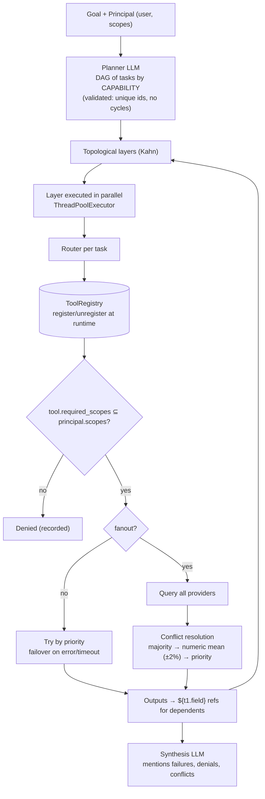

| Concept | Implementation |
|---|---|
| Dynamic registry | `ToolRegistry` is thread-safe. Tools advertise `capabilities`, `priority`, `required_scopes` and `side_effects`. |
| Capability routing | The planner only ever sees capabilities, never tool names, so providers can be swapped without re-prompting. |
| Permission scoping | `Principal(user, scopes)`. Denials are recorded with user, tool and capability for the audit log. |
| Parallelism | DAG layers run concurrently, so 3 independent 300 ms tools finish in about 300 ms instead of 900 ms. |
| Failover | `sanctions_fast` always fails, so the router falls back to `sanctions_slow`. |
| Conflicts | The two FX feeds disagree (83.20 vs 83.35). The values are within tolerance, so they are averaged and the conflict is reported. |
| Write safety | Per-tool resource locks for side-effecting tools, plus per-tool timeouts. |
| Dependencies | `${t1.name}` placeholders are resolved from upstream outputs. Tasks whose dependencies failed are **skipped**, not run on bad data. |

**Run:** `python -m p04_multi_tool_orchestrator.run`. It runs a fixed plan (deterministic) and then an LLM-generated plan.

---

## P5 · Memory-Enabled Conversational Agent

**Goal:** an agent that remembers users. It has a short-term buffer, long-term vector recall, context compression, relevance scoring and cross-session sync.

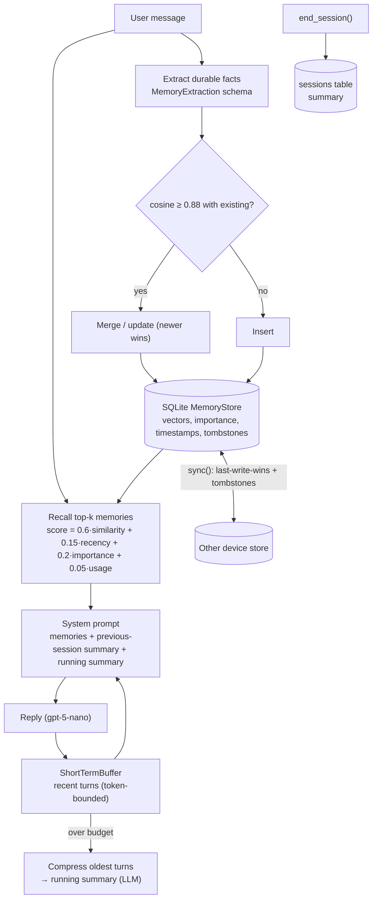

| Layer | Detail |
|---|---|
| Short-term | Most recent N messages kept verbatim. Older turns are compressed into a ≤120-word running summary. |
| Long-term | Facts extracted by the LLM (preference, fact, goal, relationship), embedded and stored per user. |
| Relevance | Similarity, plus exponential recency decay (30-day half-life), plus importance and access frequency. |
| Dedup | Semantically near-identical memories are merged, so preferences update instead of piling up. |
| Cross-session | Each session saves a summary, and the next session starts with it as context. |
| Sync | Two-way, record-level, last-write-wins on `updated_at`. Deletes are soft (tombstones), so "forget" also propagates. |

**Run:** `python -m p05_memory_agent.run`. It runs a laptop session, syncs, then runs a phone session that recalls the facts.

---

## P6 · Human-in-the-Loop Approval Agent

**Goal:** build safe, compliant systems. The agent detects uncertainty, pauses for human input, resumes with the validated context, and keeps a full audit trail.

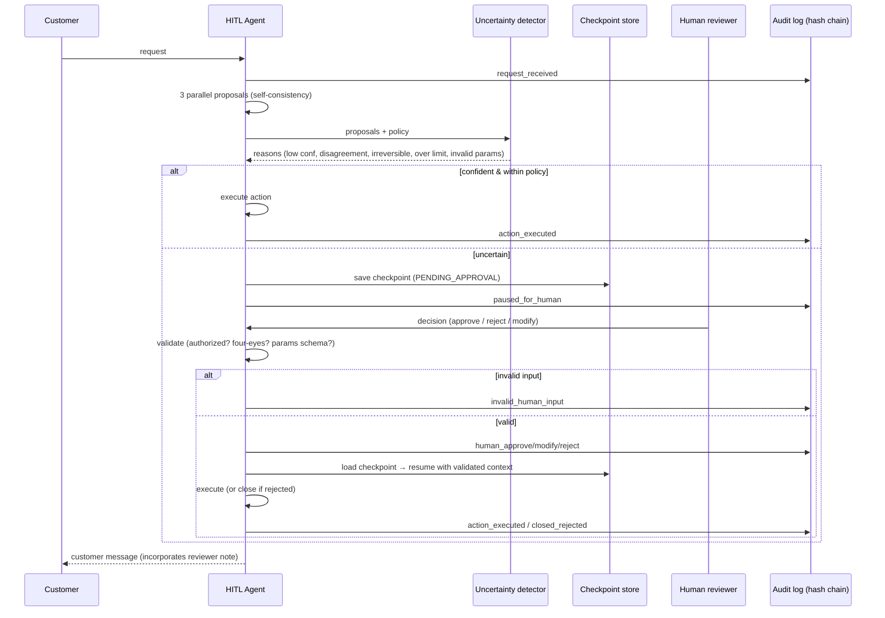

| Signal | Triggers a pause when |
|---|---|
| Self-confidence | Average across samples < 0.75 |
| Self-consistency | Fewer than 67% of the 3 samples agree on the action |
| Policy | Refund > ₹5,000 auto-limit, or the action is irreversible (`refund`, `block_card`) |
| Completeness | The model lists `missing_info`, or the proposed params fail their schema |

**Audit trail:** each entry stores `sha256(prev_hash | ts | run | actor | event | data)`. `verify()` detects any edit or deletion, and a test proves tampering is caught.

**Interfaces:**
* **CLI:** `python -m p06_hitl_approval.run` prompts for an interactive reviewer decision; `--auto` approves automatically.
* **REST:** `uvicorn p06_hitl_approval.api:app` with these endpoints:
  * `GET /runs/pending`
  * `POST /runs/{id}/decision`
  * `GET /audit/verify`

---

## P7 · Cost-Aware Agent Router

**Goal:** reduce infrastructure cost. It budgets tokens per task, routes by complexity and cost, exits early on confidence, and reports cost per decision.

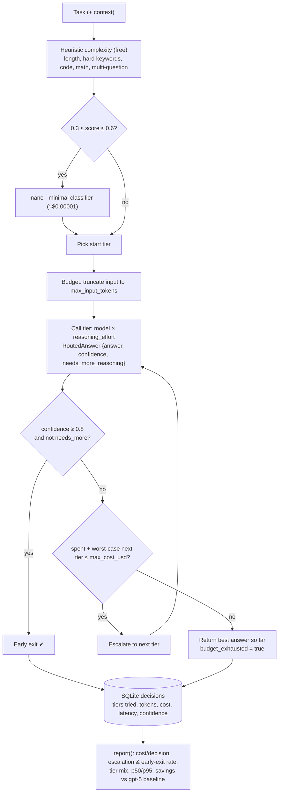

**Default tiers** use only `gpt-5-nano`:

| Tier | Model | Reasoning effort | Max output tokens |
|---|---|---|---|
| nano-minimal | gpt-5-nano | minimal | 1.5k |
| nano-low | gpt-5-nano | low | 4k |
| nano-high | gpt-5-nano | high | 12k |
| mini-medium (optional) | gpt-5-mini | medium | 12k |

The optional `gpt-5-mini` tier is added with `ROUTER_ENABLE_MINI=1`.

**Savings** are computed against a counterfactual: the same prompt and answer billed at `gpt-5` prices.

**Run:** `python -m p07_cost_router.run`

---

## P8 · Event-Triggered Automation Agent

**Goal:** production automation, not demos. It listens to webhooks and queues, executes workflows on triggers with idempotent execution, handles dead letters, and retries with backoff.

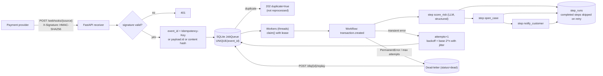

| Guarantee | Mechanism |
|---|---|
| Authenticity | HMAC-SHA256 over the raw body, checked with a constant-time comparison |
| At-most-once intake | `UNIQUE(event_id)` with `INSERT OR IGNORE`, so duplicate deliveries return the original job |
| Crash recovery | Leases: a `running` job whose lease expired is reclaimed by another worker |
| Exactly-once side effects | Each named step is recorded in `step_runs`, so a retried job skips completed steps |
| Retry policy | Exponential backoff with equal jitter, capped. Transient vs **permanent** errors are separated. |
| Poison messages | Invalid payloads or unknown event types go straight to the DLQ, which supports replay |

* **Run:** `python -m p08_event_automation.run` sends real signed HTTP requests to the app in-process. The demo covers a duplicate, a poison message, a forged signature, and an SMS gateway that fails twice and then recovers.
* **Server:** `uvicorn p08_event_automation.api:app`

---

## P9 · Multi-Agent Debate System

**Goal:** orchestrate swarms, not single agents. Multiple agents propose solutions, a critic evaluates them, voting and consensus logic picks a winner, and an aggregator synthesizes the answer with a confidence score.

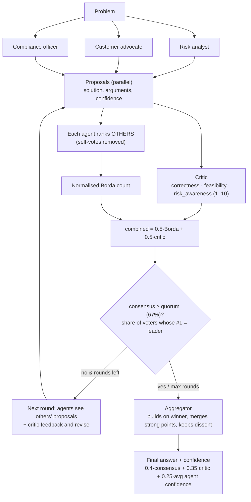

**Design choices:**

* **No self-voting:** prevents each agent simply backing its own idea.
* **Borda over plurality:** uses the full ranking information.
* **Critic separate from voters:** the quality signal is independent of popularity.
* **Dissent preserved:** minority objections are kept in the output, which matters for risk decisions.

**Run:** `python -m p09_multi_agent_debate.run`

---

## P10 · Self-Reflective Agent with Auto-Eval

**Goal:** systems that improve over time. The agent executes a task, evaluates it with an LLM-as-judge, critiques its reasoning, regenerates under constraints, and logs improvement metrics.

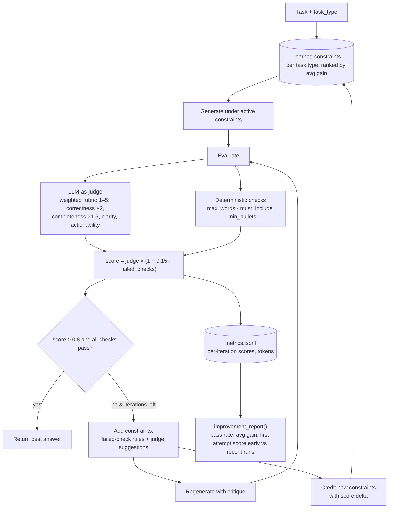

**How it improves over time:** a constraint that raised the score on a failed attempt (e.g. *"Explicitly mention: precision, recall"*) is credited with that gain. On the next task of the same type it is applied **up-front**. `first_score_recent_runs` vs `first_score_early_runs` measures that learning.

**Run:** `python -m p10_self_reflective.run`

---

## P11 · Production Agent with Observability

**Goal:** ship to production, not just localhost. It covers:

* tracing, with LangSmith support
* latency and cost dashboards
* alerting on loops and failures
* canary testing and rollback

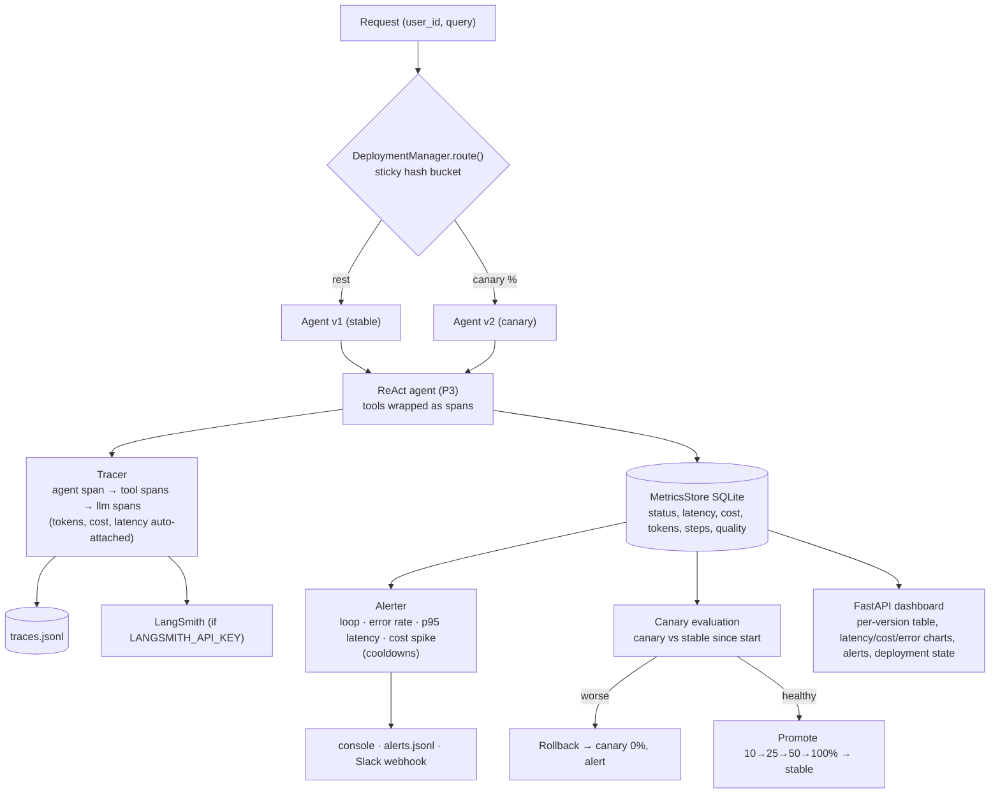

| Concern | Implementation |
|---|---|
| Tracing | OpenTelemetry-style nested spans held in `contextvars`. An LLM listener attaches child spans automatically, and totals roll up to the root span. |
| LangSmith | Spans are buffered per trace and sent parent-first as LangSmith runs, with hierarchy preserved. |
| Metrics | p50/p95 latency, error and degraded rates, average cost, tokens, steps and quality, per version and per time bucket |
| Alerts | Loop detected or too many steps, error rate > 20%, p95 > 30 s, request cost > $0.01. Each rule has a cooldown. |
| Canary | Users are hashed into buckets so routing is sticky. Rollback triggers on an error-rate delta, a quality drop or a latency regression. |
| Dashboard | `uvicorn p11_observability.dashboard:app --port 8011`, then open http://localhost:8011/ (auto-refreshes every 10 s) |

**Run:** `python -m p11_observability.run`. It sends stable traffic, then starts a canary of a deliberately weaker v2 config and evaluates it, which ends in rollback or promotion.

---

## P12 · Open-Source Framework Contribution (LoopGuard)

**Goal:** be a community builder, not just a consumer. This extends LangGraph with a new pattern and includes:

* docs and a demo
* published benchmarks
* a PR and a tutorial

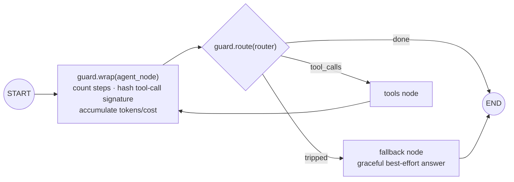

| What trips the guard | Default |
|---|---|
| Same tool call (name + args) repeated | more than 2 times |
| Alternating cycles (A,B,A,B,A,B) | detected automatically |
| Step limit | 10 |
| Token or USD budget | optional |

**Benchmark** (`benchmarks/RESULTS.md`, 300 seeded episodes, recursion_limit=25):

| Variant | Answered | Crashed | Avg steps | p95 steps |
|---|---|---|---|---|
| Baseline LangGraph | 74% | 26% | 6.4 | 12 |
| With LoopGuard | **100%** | **0%** | **4.85** | **7** |

**Deliverables:**
* `loop_guard/`: the package
* `examples/demo_graph.py`: the real gpt-5-nano demo
* `benchmarks/bench.py`: the benchmark script
* `pyproject.toml`: packaging for PyPI
* `PR_DESCRIPTION.md`: draft pull request description
* `README.md`: the tutorial

See [`p12_oss_contribution/README.md`](p12_oss_contribution/README.md) for the contribution path.

---

## Configuration reference

All settings are read from `.env`. Only the first one is required.

| Variable | Default | Used by |
|---|---|---|
| `OPENAI_API_KEY` | — | all (real mode) |
| `OPENAI_MODEL` | `gpt-5-nano` | all |
| `OPENAI_REASONING_EFFORT` | `low` | all (default effort) |
| `EMBEDDINGS_BACKEND` | `local` | P2, P5 (`openai` → `text-embedding-3-small`) |
| `LLM_MODE` | `auto` | set `mock` to force offline |
| `ROUTER_ENABLE_MINI` | off | P7 adds a `gpt-5-mini` tier |
| `WEB_SEARCH_MODEL` | `gpt-5-nano` | P2 fallback search |
| `WEBHOOK_SECRET` | dev value | P8 HMAC |
| `ALERT_WEBHOOK_URL` | — | P11 Slack/Teams alerts |
| `LANGSMITH_API_KEY`, `LANGSMITH_PROJECT` | — | P11 tracing export (`pip install langsmith`) |
| `DATA_DIR` | `./data` | where logs, DBs and traces are written |

---

## Testing strategy

`pytest` runs 38 tests offline, in about 15 seconds. The behaviour is scripted with `FakeLLM`, so every guard rail is exercised deterministically:

* **P1:** repair after a business-rule violation; give-up after retries; corrupt tool output caught.
* **P2:** fabricated quote flagged; weak retrieval triggers the search fallback.
* **P3:** loop detection; max-iteration degradation; hallucinated tool repaired.
* **P4:** parallel timing; failover; numeric conflict; permission denial; cyclic-plan repair.
* **P5:** dedup merge; recall ranking; sync including tombstones; compression; cross-session context.
* **P6:** unauthorized reviewer; four-eyes rule; invalid modification; tamper detection.
* **P7:** early exit; escalation order; budget stop; truncation.
* **P8:** duplicate delivery; exactly-once side effects across retries; DLQ and replay; bad signature.
* **P9:** Borda count and consensus.
* **P10:** pass after constraints; learned constraints applied on the next run.
* **P11:** span roll-up; canary rollback; dashboard renders.
* **P12:** guard logic; a real LangGraph run crashes unguarded and answers when guarded.

---

## Cost notes

* **Pricing:** `gpt-5-nano` costs $0.05 per 1M input tokens and $0.40 per 1M output tokens. Prices live in `common/config.py`; check them against OpenAI's pricing page.
* **Per-demo cost:** every demo prints its cost, and the router (P7) and observability (P11) projects track it per request.
* **Full run:** all 12 demos together typically cost a few US cents.
* **Reasoning tokens** are billed as output tokens. Use `OPENAI_REASONING_EFFORT=minimal` for the cheapest runs.

---

*Author: Ajeetkumar · GenAI Engineer*
